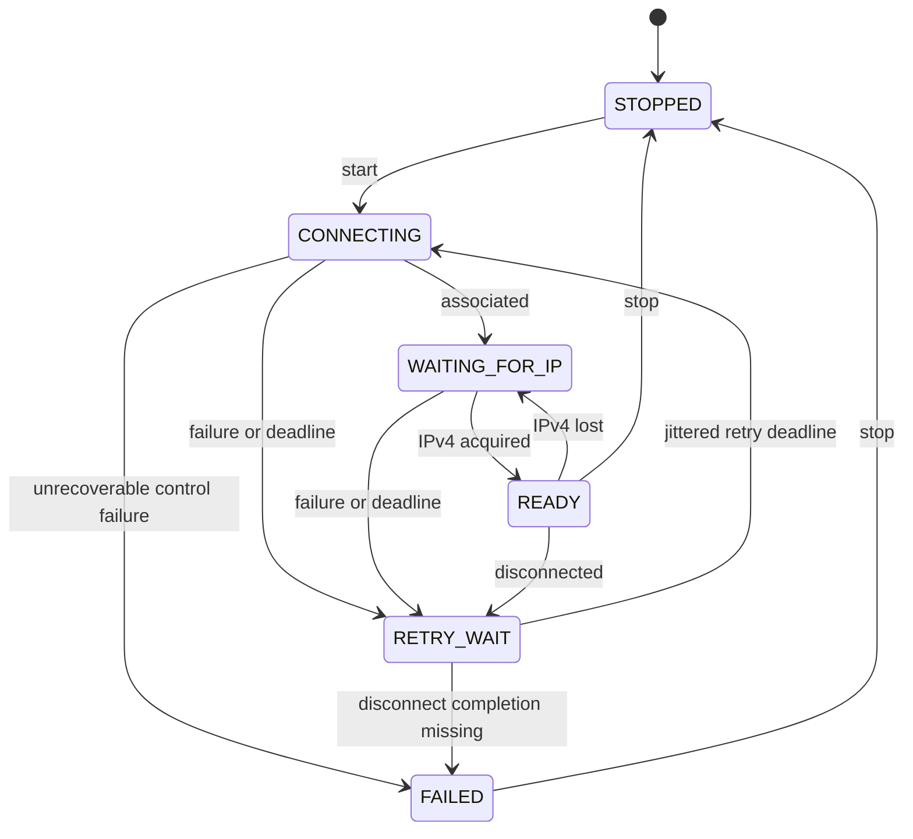

# Project integration guide

Supported SDK range: ESP-IDF `>=5.4,<5.6`. Firmware CI builds ESP32-S3 with
the 5.4 line and pinned 5.5.6; local 5.5.6 compilation does not establish
hardware qualification.

## Local development

Keep the checkout named `esp-wifi-manager`. For an external checkout, add its
path before `project.cmake` in the application's root `CMakeLists.txt`:

```cmake
cmake_minimum_required(VERSION 3.16)
set(EXTRA_COMPONENT_DIRS "../esp-wifi-manager")
include($ENV{IDF_PATH}/tools/cmake/project.cmake)
project(my_device)
```

Use `REQUIRES esp-wifi-manager` in the consuming component. Use either this local
method or the pinned Git dependency in the README. Commit the application's lock
file when consuming a Git dependency; don't edit downloaded managed components.

## Credentials and storage

`wifi_manager_start()` accepts either explicit credentials or NULL to use the
driver's saved protected-network configuration. Explicit credentials use byte
lengths; no terminator is needed inside the public fixed-size arrays:

```c
#include <string.h>
#include "wifi_manager.h"

static esp_err_t connect_with_credentials(wifi_manager_handle_t manager)
{
    const char *ssid = "your-network";
    const char *password = "your-passphrase";
    wifi_manager_credentials_t credentials = {0};
    credentials.ssid_len = strlen(ssid);
    credentials.password_len = strlen(password);
    if (credentials.ssid_len > sizeof(credentials.ssid) ||
        credentials.password_len > sizeof(credentials.password)) {
        return ESP_ERR_INVALID_ARG;
    }
    memcpy(credentials.ssid, ssid, credentials.ssid_len);
    memcpy(credentials.password, password, credentials.password_len);
    return wifi_manager_start(manager, &credentials, WIFI_MANAGER_STORAGE_RAM);
}
```

The component copies explicit credentials into the driver before returning;
the caller's credential object need not remain alive. Keep real secrets out of
source control. `WIFI_MANAGER_STORAGE_FLASH` explicitly persists credentials via
ESP-IDF. RAM mode does not persist them.

Supported inputs:

| Input | Supported values |
|---|---|
| SSID | 1–32 non-NUL bytes; UTF-8 limits count bytes |
| Personal-network passphrase | 8–63 non-NUL bytes |
| Open network | Empty password and `allow_open = true` |
| Raw 64-character hexadecimal PSK | Unsupported |
| WPA-Enterprise credentials | Unsupported |

Explicit credentials with a nonempty password set `threshold.authmode` to
`WIFI_AUTH_WPA2_PSK`, preserving a WPA2 minimum. An empty password is rejected
unless `allow_open = true`; that explicit open-network path sets
`WIFI_AUTH_OPEN`. Saved configurations retain their existing driver threshold.

Saved open networks require explicit credential input with open-network opt-in;
they are not accepted by the NULL-credential path. Changing the storage setting
alone is not assumed to reload NVS. After a RAM-configured run, NULL credentials
return `ESP_ERR_INVALID_STATE` until destroy/recreate. You can still restart
with explicit credentials in either storage mode.

A failed start can have applied driver configuration or persisted explicitly
supplied FLASH credentials before a later driver step fails. Correct the
reported error, stop if the driver started, and retry deliberately.

## Status callbacks

```c
#include "esp_log.h"
#include "wifi_manager.h"

static void on_wifi_state(const wifi_manager_status_t *status, void *context)
{
    (void)context;
    ESP_LOGI("network", "state=%d attempts=%lu error=%s",
             (int)status->state, (unsigned long)status->attempts,
             esp_err_to_name(status->last_error));
    /* Enqueue application work here. Don't start/stop/wait/destroy here. */
}
```

Pass the callback and your context to `wifi_manager_create()`. The snapshot is
immutable for the duration of the call; copy it if you need it later. Context
must remain valid through destruction. `get_status()` is safe inside a callback;
lifecycle/wait calls from that worker return `ESP_ERR_INVALID_STATE`.

Callbacks run on the manager worker and must return promptly. Application tasks
should consume queued notifications and start or recover their services. IPv4,
netmask and gateway fields use ESP-IDF's network-byte-order representation.
They are cleared when readiness is lost and updated on address changes while
already READY.

## States and errors



`stop()` is available from every active state; the diagram omits repeated stop
arrows for readability. A stopped manager can start again. Attempt deadlines and
retries are handled by the worker; the SDK default event loop never sleeps to
implement retry delays. Optional IPv6 errors appear in status without blocking
IPv4 readiness.

| Operation/result | Meaning and application response |
|---|---|
| `create`: `ESP_ERR_INVALID_STATE` | Another manager or initialized driver exists; resolve ownership |
| `start`: `ESP_ERR_NOT_FOUND` | No saved SSID; use explicit credentials or provisioning |
| `start`: `ESP_ERR_INVALID_ARG` | Invalid credentials, storage choice, or unsupported saved format |
| `start`: `ESP_ERR_INVALID_STATE` | Manager not stopped, failed stop left driver active, or NULL input after RAM use |
| `wait_ready`: `ESP_ERR_TIMEOUT` | Wait budget expired; recovery continues |
| `wait_ready`: `ESP_ERR_INVALID_STATE` | Stopped/failed state, or forbidden worker context |
| Any driver error | Inspect the returned `esp_err_t` and current status |
| Status `FAILED` | Stop, inspect the error, and restart from an application task |

A missing intentional-disconnect completion is bounded by the association
wait budget. The manager enters FAILED rather than starting an overlapping
attempt with uncertain event ordering.

## Provisioning handoff

Perform the handoff from an application task:

1. `wifi_manager_stop(manager)` and check its result.
2. Configure/start your APSTA portal using the initialized driver. The manager
   ignores station events while stopped, allowing portal scans without retries.
3. Select `WIFI_STORAGE_FLASH` explicitly before saving portal credentials.
4. Stop the portal and its Wi-Fi use before restarting the manager. Pass the newly
   provisioned credentials explicitly, or reboot/recreate to reload saved ones.
5. Destroy only after all driver users and concurrent public API users exit.

The manager does not stop application HTTP/DNS servers, free portal resources,
choose GPIOs, erase NVS, or restart the device. Your application owns those
policies. Keep NVS, esp-netif and the default event loop alive through destroy.

## CI and validation

The standalone example verifies that the public C API can be used without
mini_dns headers or services. Host tests run the production policy and driver
adapter with injected time, randomness and fake ESP/FreeRTOS APIs. Fake radio
and event behavior does not replace device testing.

Run the [hardware matrix](hardware-tests.md) on your chosen board/router before
shipping firmware. Use [validation](validation.md) to distinguish measured host
coverage from hardware qualification. Pin dependencies in each consumer, and
re-run its own service and recovery tests when upgrading this component.
